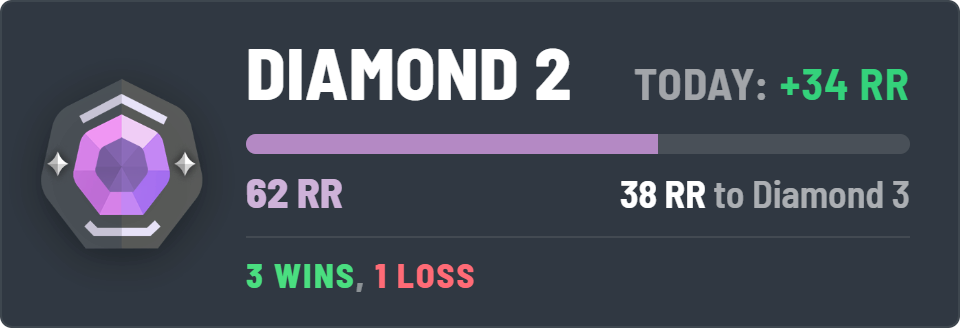
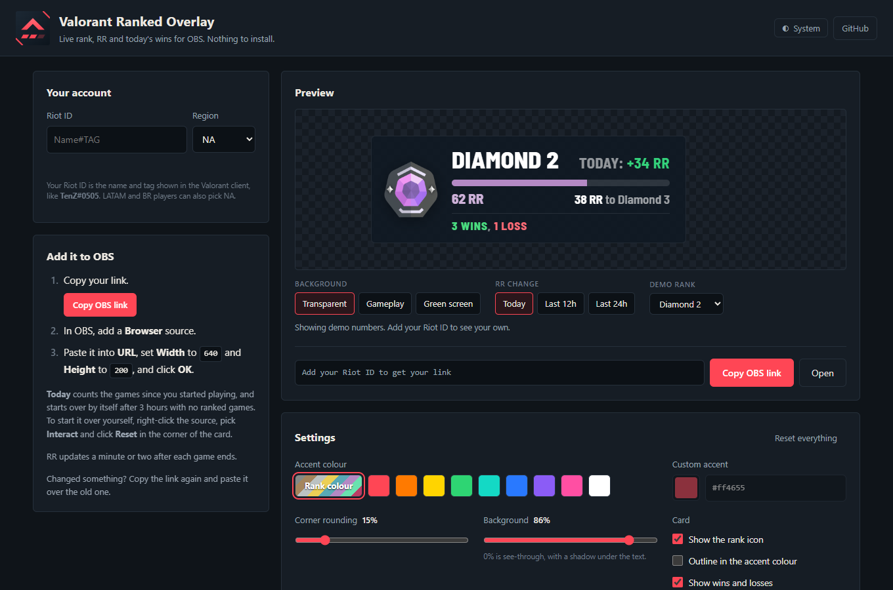
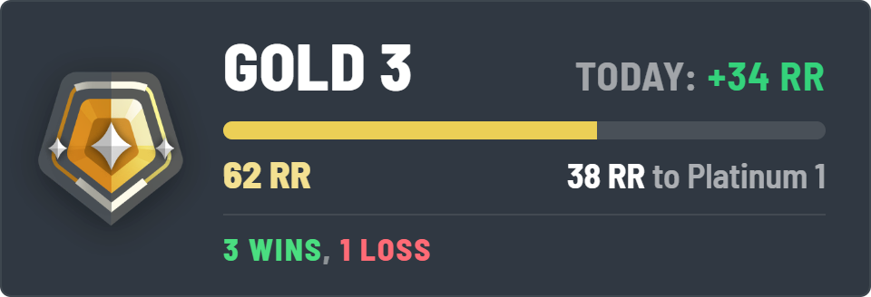
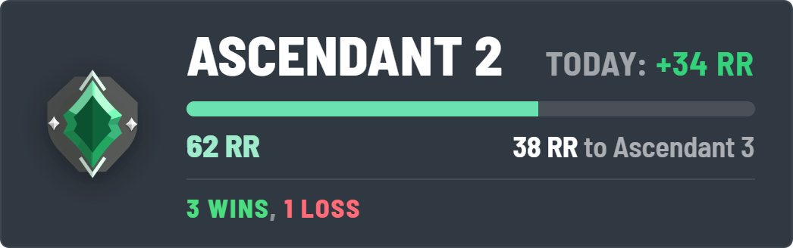
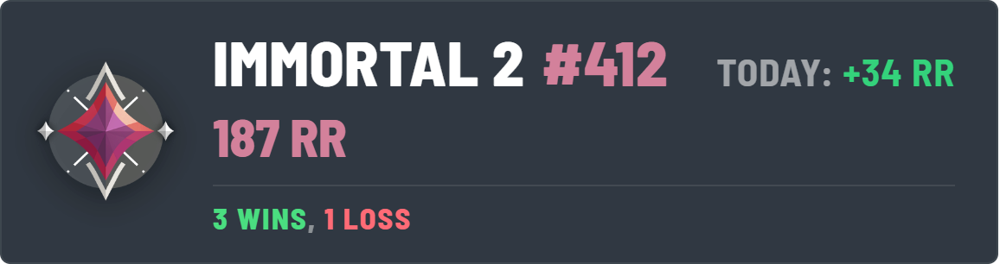
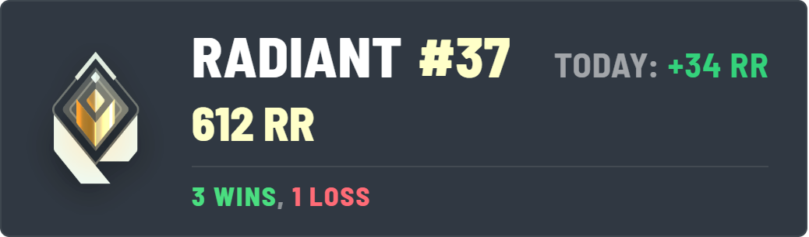
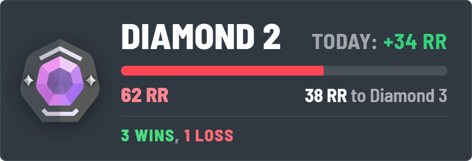
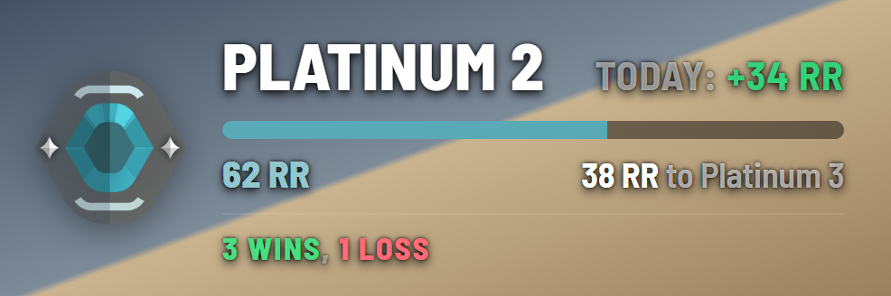

# Valorant Ranked Overlay for OBS

A free, live Valorant ranked overlay for streamers. It shows your **rank**, your **RR**, how much RR you've gained today, and today's **wins and losses**, and it updates on its own while you play. Stats come from the [HenrikDev API](https://docs.henrikdev.xyz).

It runs as a website. You don't download, install or run anything on your PC, so there are no antivirus warnings and nothing to keep updated.

### 👉 [Open Valorant Ranked Overlay](https://fwsoapy.github.io/valorant-ranked-overlay/)



---

## Contents

- [Set it up](#set-it-up)
- [What it shows](#what-it-shows)
- [Options](#options)
- [Using it in OBS](#using-it-in-obs)
- [Troubleshooting](#troubleshooting)
- [FAQ](#faq)
- [How it works](#how-it-works)
- [Working on the code](#working-on-the-code)

---

## Set it up

1. Open the [website](https://fwsoapy.github.io/valorant-ranked-overlay/), type your Riot ID (like `Name#TAG`) and pick your region.
2. Pick an accent colour and tweak the card. The preview shows demo numbers until your Riot ID is in, then your real ones.
3. Click **Copy OBS link**.
4. In OBS, add a **Browser** source, paste the link into **URL**, set the size to **640 x 200**, and click OK.

That's it. The overlay keeps itself up to date. If you change something later, copy the link again and paste it over the old one.



---

## What it shows

The card takes your rank's colour unless you pick your own.

| Rank | Looks like |
| --- | --- |
| **Iron to Ascendant**: your rank, a bar with your RR out of 100, and how much RR you need for the next rank. |  |
| |  |
| **Immortal and Radiant**: your RR with no bar (it doesn't stop at 100), and your leaderboard spot when Riot has one. |  |
| |  |
| **Any colour**: here in Valorant red. |  |
| **See-through**: background at 0%, with a shadow under the text. |  |

**Today** is the RR you've gained or lost and your wins and losses in this sitting. It counts your games back to the first one with less than 3 hours before it, so it starts over by itself when you come back the next day. You can also press **Reset** (see [Using it in OBS](#using-it-in-obs)) or count the last 12 or 24 hours instead.

A game that gained RR counts as a win and one that lost RR as a loss. A loss that rank protection turned into +0 still counts as a loss, and any other +0 game shows as a draw.

---

## Options

Everything is on the setup page, and the link it gives you remembers all of it.

| Option | What it does |
| --- | --- |
| **Riot ID and region** | Your `Name#TAG` and NA, EU, AP, KR, LATAM or BR. You can also paste a tracker.gg profile link. |
| **Accent colour** | Your rank's colour (the default), a swatch, or any custom colour. |
| **Corner rounding** | From sharp corners to fully round. |
| **Background** | How solid the card is. Below 40% the text gets a shadow so it stays readable over gameplay. |
| **Card** | Show or hide the rank icon, add an outline, show or hide wins and losses. |
| **RR change** | **Today** (the default, see above), **Last 12h** or **Last 24h**. |
| **Update speed** | Auto checks every 2 minutes while you're live. You can slow it to every 5 or 10 minutes. |
| **Preview background** | Only changes the setup page preview (transparent, gameplay or green screen). Your stream sees a transparent overlay. |
| **Edit a link you made before** | Paste an old link under *More options* to load all its settings back. |

---

## Using it in OBS

Right-click the Browser source and pick **Interact**. Hover the card and a **Reset** button shows in its corner. Click it to start today's RR and wins over from now. Viewers never see the button, since it only appears under your mouse.

Have the overlay in a few scenes? They share their data, so it doesn't cost extra requests, and a Reset in one counts in all of them.

---

## Troubleshooting

**The preview shows the same numbers every time**
That's the demo, which shows until you add your Riot ID.

**A small orange message appears under the overlay**
It's the actual problem, and it clears on its own once it's fixed.
- *no Valorant account with that Riot ID in this region*: check the spelling, the tag after the `#`, and the region.
- *stats service is busy, trying again shortly*: HenrikDev or the shared proxy hit a limit for a moment. It retries by itself.
- *request failed: couldn't reach the proxy*: a network hiccup. It retries by itself and keeps your last numbers on screen meanwhile.
- *no Riot ID in the link*: the link was made without one. Add yours on the setup page and copy the link again.

**It says Unrated**
You haven't finished your placement games this act. The message under the card says how many are left.

**My last game isn't showing**
RR shows up a minute or two after a game ends, once Riot publishes it and the overlay checks again.

**It looks frozen while I'm not streaming**
To save requests, it only checks every 10 minutes while OBS is open but not streaming, recording or running the virtual camera, and not at all while the source is hidden. It catches up when you go live or show the source.

**Everything is blank in OBS**
Check the URL in the source is the full link from the setup page, then right-click the source and pick **Refresh cache of current page**.

---

## FAQ

**Do I need to download anything?**
No. Everything runs in the page.

**Does it cost anything?**
No, it's free.

**Do I need a Riot or HenrikDev account?**
No. Your Riot ID is all it needs.

**Can I move or resize it?**
Yes, it's a normal OBS Browser source. Move it, scale it and add filters like any other source.

**Does it slow down Valorant?**
No. It checks for new numbers every couple of minutes, and that's all it does.

**What's saved about me?**
Nothing on a server. Your Riot ID and options live in the link, and a small cache lives in your own browser. The overlay asks HenrikDev for your public ranked stats through a small proxy, and that's all.

**Does it work for console?**
Not yet. It reads PC ranked.

---

## How it works

The overlay is a web page that does its own work. It reads your rank and recent ranked games, works out your RR, today's change and record, and draws the card. Rank icons and colours come from [valorant-api.com](https://valorant-api.com).

HenrikDev needs an API key, and a key inside a web page is a key anyone can copy. So the page asks a small Cloudflare Worker, which adds the key and passes back only what the overlay needs. The Worker keeps each answer for a minute and only re-reads your match history after a new game, so one overlay costs about one request every two minutes.

---

## Working on the code

You only need this if you're changing the overlay.

`src/` is the only place anything is written by hand:

```
src/overlay.html      the overlay (what OBS shows)
src/web/engine.js     the engine: rank, RR, today's change, caching, requests
src/web/index.html    the setup page
web/worker.js         the Cloudflare Worker the page talks to
```

The website in `docs/` (served by GitHub Pages) is **generated** from those. After changing anything in `src/`:

```bash
python tools/build.py          # rebuild docs/
python tools/build.py --check  # what CI runs: fails if docs/ is out of date
```

To try it locally, run `python -m http.server` inside `docs/` and open `http://localhost:8000`. `preview/ranks/` shows the overlay at every rank.

Tests (they need Node.js 22 or newer) run the engine on fixtures in HenrikDev's answer shape and the Worker against a fake HenrikDev, and check the request budget:

```bash
node --test "tests/*.test.*"
```

`web/README.md` covers deploying the Worker.

---

## License

MIT, see [LICENSE](LICENSE). Use it, edit it, ship it, just don't blame us if Riot changes things.

## Credits

Built by **fwsoapy** on Discord. Stats powered by the [HenrikDev API](https://docs.henrikdev.xyz), rank icons from [valorant-api.com](https://valorant-api.com).

## Legal

Valorant Ranked Overlay isn't endorsed by Riot Games and doesn't reflect the views or opinions of Riot Games or anyone officially involved in producing or managing Riot Games properties. Riot Games, and all associated properties are trademarks or registered trademarks of Riot Games, Inc.
